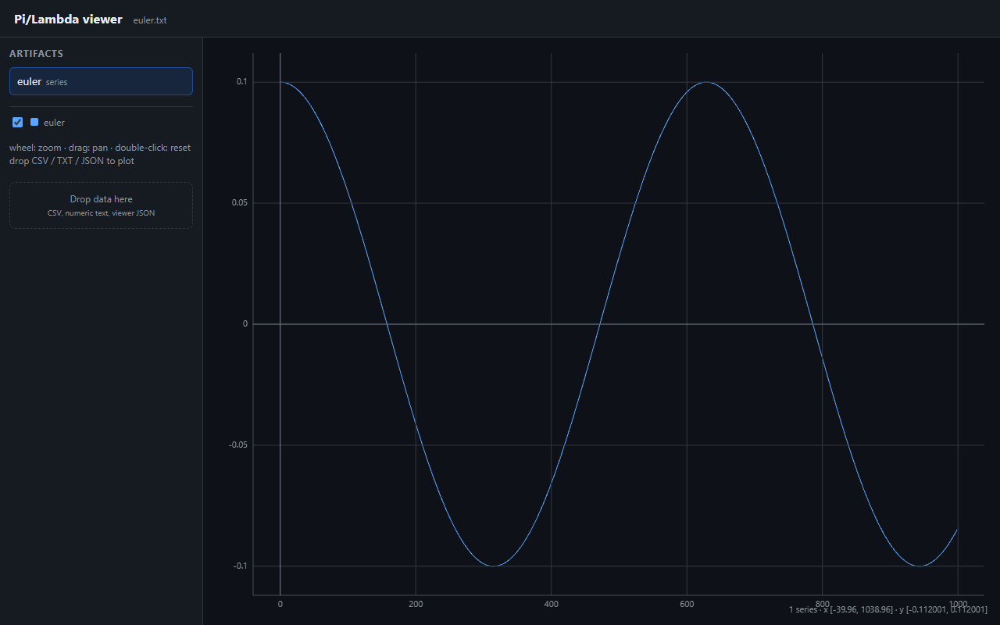
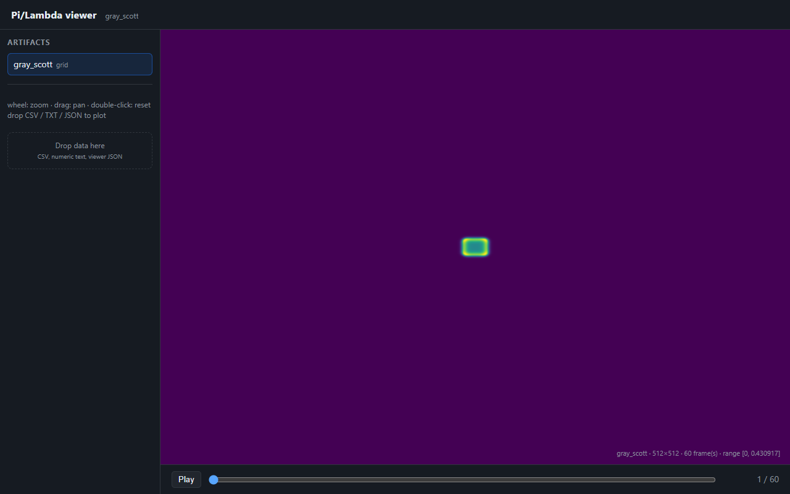

# Universal WebGL viewer

`tools/viewer.py` is a single renderer for all Lambda/Pi runs. It is not
copied into programs or output files; it reads raw data and serves a small
shared WebGL application.

```powershell
# Pi output directory (results.json + CSV + frames.bin)
pi view out/gray_scott
# or directly
python tools/viewer.py out/gray_scott

# a simulation that prints one number per line
lambda.exe > euler.txt
python tools/viewer.py euler.txt
# or pipe directly
lambda.exe | python tools/viewer.py -

# CSV / JSON / LMB1 / .frames.bin
python tools/viewer.py run.csv
```

The command starts a server bound to `127.0.0.1` on an ephemeral port, opens
the browser, and serves only the selected data directory plus the static
viewer assets. Data paths are resolved and checked against the served root;
large frame files use byte-range requests. `--no-open` and `--port` are available.




## Features

- WebGL series rendering: line, points, bars; multiple series; legend toggles.
- Mouse-wheel zoom, drag pan, double-click reset, axis ticks, data extents.
- 2D field/animation viewer with a WebGL texture, colormap, frame slider and
  play/pause.
- Large Pi `.frames.bin` sequences are read lazily with HTTP range requests;
  the browser never downloads a multi-GB file just to show one frame.
- Drag and drop CSV, numeric text, or viewer JSON directly onto the page.
- No Python plotting stack, no matplotlib, no embedded SVG/JS per run.

## Data formats

- Pi `results.json` artifacts, resolved to sibling `.csv`/`.frames.bin`.
- CSV `x,y` series, generic numeric CSV (first column x), or
  `row,col,value` grids.
- Plain numeric text (one or more numbers per line); index becomes x.
- LMB1 Lambda `--data` streams.
- Viewer JSON manifest: `{ "series": [...], "grids": [...] }`.

The legacy generated `report.html` remains for compatibility, but the
universal viewer is the recommended interactive path.
