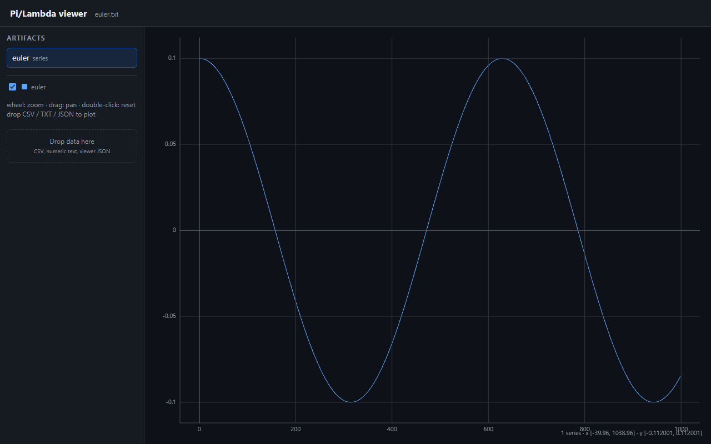

# Lambda
[](https://github.com/deterministic-plen/lambda/actions/workflows/ci.yml)


**Lambda is an impure, eagerly evaluated, statically typed functional language
in the ML/Lisp tradition: a strict lambda calculus with Hindley–Milner
inference, algebraic data types, flat arrays, reference-counted containers, and
a native-code compiler.**  It is designed as a *compute* language: small,
predictable, and fast enough to sit underneath a coordinator such as
[Pi](Pi/).

> **Status.** Type checking is always on: a type error is a compile error
> unless `--allow-dynamic` explicitly opts into the boxed fallback.
> `--strict` no longer exists (strict checking is the default).  The language
> now includes infix-style `match` arms, `Array<T>`/`#[...]` literals, string
> indexing, `loop`/`recur`, inferred borrows, halting warnings, explicit world
> objects and a framebuffer GUI library.  Fix status for the current review is
> tracked in [`docs/PR-COMPLIANCE.md`](docs/PR-COMPLIANCE.md).

```
source .lambda (+ includes)
  │ lexer / layout-sensitive parser
  │ resolver
  │ purity + common-subexpression sharing
  │ Hindley–Milner inference (strict; --allow-dynamic opt-in fallback)
  │ capture analysis / λp purity
  ▼
typed AST
  │ LLVM IR + C runtime
  ▼
native executable
```

## Requirements

- **Python 3.10 or newer.**  The driver, test harness and tools are CPython
  scripts.  `run_tests.py` needs `PyYAML` (`pip install pyyaml`).
- **clang on `PATH`.**  It compiles the generated LLVM IR and the bundled C
  runtime.  A C++ compiler is needed only for the Pi runtime and C++ example
  checks.
- **A linker.**  `lld` is *optional*: the driver probes
  `lld-link`/`ld.lld`/`lld`, adds `-fuse-ld=lld` when one is found, and uses
  clang's default linker otherwise (PR C4).  Earlier revisions of the driver
  hard-coded lld, but a plain clang install builds fine.
- **Optional test extras.**  `pytest` for the Pi static tests; `pygments` for
  `editors/test_highlight.py` (and the viewer test helpers).
- Linux/macOS builds link `libm`/`pthread` (and `libdl` on older glibc)
  automatically; Windows needs no additional libraries.

## Design goals

1. **Stay a lambda calculus.**  Definitions are `name → value`; application is
   prefix; currying is real.  There are no statements, loops, or mutable
   variables.  Syntax is added only when it removes a bug class or unlocks a
   common pattern.
2. **Native performance without leaving the language.**  Scalars and small
   records are unboxed; known calls are direct calls; self-recursion uses
   `musttail`; immutable array metadata is cached; RC fast paths are inlined.
   The bigint library reaches within ~2.5× of Python's C-backed integers
   without a single bigint primitive.
3. **Predictable memory.**  Fixed-size values live in registers/stack; heap
   values are reference-counted; arrays are flat mutable buffers under a
   single-owner convention (aliasing is not yet diagnosed, see
   [Flat arrays](#flat-arrays)); `&` gives a checked read-only borrow.  There
   is no tracing GC.
4. **Opt-in parallelism.**  `pmap`, `arrayi-pmap`, and `arrayf-pmap` run pure
   functions over disjoint outputs with OS threads.  A CUDA/NVRTC path for
   `arrayf-pmap` exists in the compiler/runtime but is **not wired up** in the
   current build (see [Parallelism and GPU](#parallelism-and-gpu)); there are
   no user threads, channels, or races.
5. **Mathematics first.**  `Int`, `Float`, `Bool`, arrays, product/sum types,
   a complex library, a bigint library, and a streaming plotting path are part
   of the distribution rather than afterthoughts.

## Quick start

```sh
python lambda.py hello.lambda -o hello
./hello
```

```lambda
; hello.lambda
(println "hello")
```

A program is a block of definitions followed by one final expression.  The
runtime prints the final value when the program ends, so a program ending in
`(println x)` prints `x` twice (once from `println`, once as the final value);
end with the bare value to print once.  Comments start with `;` (`--` is not a
Lambda comment).

The driver prints `Success!` followed by a `Run ./<path>` hint naming the output
path relative to the current directory (on Windows the executable gets a `.exe`
suffix).  With `--dynamic` the message is
`Success! (boxed --dynamic backend) Run ...`.

A definition takes exactly one atom, so parenthesize compound values:

```lambda
add → (λa b. (+ a b))
square → (λx. (* x x))
answer → (square (add 2 3))
(println answer)
```

Useful flags:

| flag | meaning |
| --- | --- |
| `--allow-dynamic` | if type inference fails, warn and compile with the boxed backend instead of rejecting the program |
| `--dynamic` | use the fully boxed backend for a program that type-checks (checking always runs) |
| `--data` | binary `write-*` output; suppresses the final print |
| `--input` | enable `read-line`, `read-int`, `read-float` |
| `--exit-code` | require an `Int` result and use it as the process exit status (no final print) |
| `--layout` | parse `data` declarations and print their type-algebra layouts; do not compile |
| `-L, --lib DIR` | add a library/include directory (repeatable) |
| `--keep-ir` / `--dump-ir` | keep or print LLVM IR |
| `--no-musttail` | disable `musttail` emission (debugging) |
| `--no-warn-infix` | suppress the likely-infix warning for `z == 1`-style applications |
| `--no-halt-warnings` | suppress the warning-only recursion termination analysis |
| `--debug` | print the inferred program type and Python tracebacks for internal errors |

Type checking is always on; the old `--strict` flag has been removed because
strict checking is now the default.

Environment: `LAMBDA_PATH` for include search, `LAMBDA_THREADS` for worker
count, `LAMBDA_GPU=1` for the (currently not dispatched) CUDA path for
`arrayf-pmap`, `LAMBDA_STATS=1` for allocation statistics.  Include paths are
confined to the project and `-L` roots; `LAMBDA_ALLOW_INCLUDE_OUTSIDE=1` is the
explicit escape hatch.  `LAMBDA_TRACE=1` prints `(cycle state)` state reports,
`LAMBDA_PROFILE=1` prints a cycle/CPU summary at exit, and
`LAMBDA_GUI_HEADLESS=1` makes GUI programs write a PPM (`LAMBDA_GUI_OUT`).

## Language

### Functions and application

```lambda
id → (λx. x)
const → (λx y. x)
compose → (λf g x. (f (g x)))
```

Application is left-associative and prefix: `(f a b)` means `((f a) b)`.
There are no infix operators, so `(+ a b)` and `(== x 0)` are calls.  A
multi-parameter `λ` is compiled as one native function, but remains curried
when partially applied.

### Types

Inference covers `Int`, `Bool`, `Float`, `String`, `[T]`, products, sums,
arrays, and function types.  Numeric operators are overloaded over `Int` and
`Float` but require homogeneous operands; unconstrained numeric variables
default to `Int`.  Annotate when you need a specific specialization:

```lambda
squaref → (λx: Float. (* x x))
squarei → (λx. (* x x))       ; Int -> Int
```

Function return types are optional.  Write them before the dot or after the
body; when omitted the body's type is inferred:

```lambda
inc  → (λx: Int -> Int. (+ x 1))     ; explicit return type
inc2 → (λx: Int. (+ x 1))            ; inferred Int
inc3 → (λx: Int. (+ x 1) : Int)      ; explicit, trailing form
```

The compiler also runs a warning-only termination analysis.  A direct recursive
call is accepted when a bounded rank variable strictly decreases (for example
`(<= n 0)` with `(f (- n 1))`, or `(empty? xs)` with `(f (tail xs))`); otherwise
the compiler prints `warning: recursion in 'f' may not halt` and continues.
The solver understands increasing counters bounded by a stable limit
(`(>= i (arrayb-length a))` with `(loop (+ i 1))`), but not arbitrary rank
functions.

Borrow inference is automatic for flat arrays: a parameter that is only
inspected (never returned, stored or captured) is passed as a borrow, so the
callee does not consume it.  `&x` is an explicit borrow, and `: linear` opts a
parameter out of inference (it stays consuming).

Type checking is strict and always on.  If inference fails, compilation stops
with a `file:line:col: type error: ...` diagnostic; there is no silent fallback.
`--allow-dynamic` opts into the old fallback for legacy programs: the driver
warns and recompiles the whole program with the boxed dynamic backend.  That
backend is best-effort (it cannot compile programs using sums/records or
several library primitives — see [Limitations and roadmap](#limitations-and-roadmap))
and can be hundreds of times slower.  `--dynamic` forces it for a program that
does type-check, e.g. for differential testing.  The old `--strict` flag no
longer exists.

### Products, sums, and enums

```lambda
type Complex (re: Float, im: Float)
type Vec3 (x: Float, y: Float, z: Float)

conj → (λz: Complex. (Complex (Complex-re z) (- 0.0 (Complex-im z))))
dot  → (λa: Vec3 b: Vec3.
        (+ (* (Vec3-x a) (Vec3-x b))
           (+ (* (Vec3-y a) (Vec3-y b)) (* (Vec3-z a) (Vec3-z b)))))
```

Product types are declared with `type`.  A legacy unboxed product keeps the
scalar-only form `type Vec3 (x: Float, ...)`; a product that holds boxed fields
(lists, strings, other products) uses the data-backed form
`type Token = (kind: Kind, value: [Int])`, which behaves like a single-variant
`data` type and gets generated `Token-kind` / `Token-value` accessors.  Sums use
`type Shape (...)` with variants separated by `|` and payload binders
`Variant (field: Type, ...)`:

```lambda
type Shape (
  Circle (r: Float)
| Rect (w: Float, h: Float)
| Point
)

area → (λs: Shape.
  match s
    Circle r → (* 3.141592653589793 (* r r))
  | Rect w h → (* w h)
  | Point → 0.0)

(area (Rect 2.0 3.0))     ; 6.0
```

`match` has two forms:

* **Variant match** (enums, sums, data): arms name every variant; the old
  `match e with A → ...` spelling still works, and `|` separates arms.
* **Literal match** (Int, Float, Bool, String): arms are literals and a
  mandatory `_` default:

  ```lambda
  describe → (λc.
    match c 43 → "plus"
    | 45 → "minus"
    | 91 → "open"
    | 93 → "close"
    | _ → "other")
  ```

  Character literals are Ints: `'['` is 91 and `']'` is 93.  The subject may
  use character indexing: `match s[0] 'a' → ... | _ → ...`.  Tagged-union
  matches must list every variant unless a `_`/`default` catch-all is
  explicitly intended; a missing arm without a default is a compile error.
  This replaces the old `if (== c 91)` chains; see `learn/brainf.lambda`.

A named data product with an enum field is the Token idiom:

```lambda
enum Kind (Num, Op)
type Token = (kind: Kind, value: [Int])

t → (Token Num [1, 2, 3])
[(Token-kind t), (Token-value t)]
```

Product values with only scalar/enum fields are unboxed LLVM structs passed by
value; data-backed products and sums that reach arrays/lists are boxed.  Current
restrictions: legacy unboxed product fields are scalar/enum only, types are
monomorphic, and field sugar `z_re` splits at the last underscore and is
resolved before inference, so annotate parameters when using it.

### Typed field helpers

`lib/field.lambda` makes the planar convention explicit:

```lambda
include "lib/complex.lambda"
include "lib/field.lambda"

n → 3
z0 → (field-new 2 n)
z1 → (field-set z0 2 n 0 0 1.0)   ; real part of element 0
z2 → (field-set z1 2 n 0 1 2.0)   ; imaginary part of element 0
real0 → (field-get z2 2 n 0 0)
```

`lib/complex.lambda` and `lib/vec3.lambda` provide the scalar product helpers.
`Array<Complex>` and `Array<Vec3>` are the planar `ArrayF` conventions described
above.

### Qualified names

```lambda
Complex::add → (λa: Complex b: Complex.
  (Complex (+ a_re b_re) (+ a_im b_im)))
(Complex::add z w)
```

`::` is part of a global name, not a module system.  It is a naming convention
for libraries (`Complex::add`, `mat-mul`); single `:` remains the
type/field/match separator.

### Logic and bit operations

```lambda
valid → (and (> x 0) (< x 100))
either → (or flag (== x 0))
negated → (not flag)
```

`and`, `or`, `not` are `Bool` primitives.  `and`/`or` evaluate both operands; if
the right side can fault, write the `if` form.  `&`/`bit-and` are Int
bitwise operations, as are `|`, `bit-xor`, `!`/`bit-not`, `shl`, `shr`,
`popcount`.

### Integer semantics

`Int` is a signed 64-bit two's-complement integer (LLVM `i64`).  These results
are defined, and were verified against the current compiler (PR 2.4a); none of
them is undefined behaviour:

| expression | result |
| --- | --- |
| `(+ 9223372036854775807 1)` | `-9223372036854775808` (wraps) |
| `(sum [9223372036854775807, 1])` | wraps the same way |
| `(/ -9223372036854775808 -1)` | `-9223372036854775808` (no trap) |
| `(shl 1 64)` | `1` (the shift count is masked to its low 6 bits) |
| `(shl 1 -1)` | `-9223372036854775808` |
| `(shr -8 200)` | `72057594037927935` (`shr` is a logical, zero-fill shift) |

Integer literals outside the `Int` range are compile errors.  Arithmetic
overflow wraps rather than trapping; division by zero is a checked runtime
error, and `float->int` truncates and saturates (NaN becomes `0`).

### Lists

Lists are persistent, homogeneous linked lists:

```lambda
xs → [1, 2, 3]
ys → (cons 0 xs)
zs → (map (λx. (* x x)) xs)
total → (sum xs)
```

`map`, `pmap`, `range`, `head`, `tail`, `empty?`, `nil`, and `sum`/`product`
are available.  A list is boxed and reference-counted.

Tail-recursive loops with many state variables use `loop`/`recur`; the parser
lowers them to a local recursive function, and the existing tail-call lowering
keeps them in constant stack space:

```lambda
sum-to → (λn.
  loop (i → 0) (acc → 0)
    if (> i n) then acc else (recur (+ i 1) (+ acc i)))
(sum-to 1000000)     ; 500000500000
```

`loop` is soft syntax: a definition or variable named `loop` is still an
ordinary identifier.

### Flat arrays

For numeric state, use one of three mutable flat buffers:

| constructor | element |
| --- | --- |
| `(arrayf n init)` | `Float` (double) |
| `(arrayi n init)` | `Int` (int64) |
| `(arrayb n init)` | byte (0–255) |

To instantiate an array from values, use the list constructors:

```lambda
xs → (arrayf-of [1.0, 2.5, -3.0])
is → (arrayi-of [1, 2, 3])
bs → (arrayb-of [0, 255, 7])
```

They consume the list and copy its elements into one flat buffer; an empty list
gives a zero-length array.  The constructor forms are `arrayf-of`, `arrayi-of`,
and `arrayb-of`.

Annotations may use the generic form: `Array<Float>` = `ArrayF`,
`Array<Int>` = `ArrayI`, `Array<Bool>` = `ArrayB`, and `Array<T>` for any other
element type is a boxed array whose slots hold normal Lambda values.  Sums,
data-backed products (including `Token`), strings, lists and nested arrays all
work as elements:

```lambda
enum Kind (Num, Op)
type Token = (kind: Kind, value: [Int])

tokens → #[ (Token Num [1, 2]), (Token Op [3]) ]   ; Array<Token>
n → (array-length tokens)
t → (array-get tokens 1)
back → (array-set tokens 0 t)
```

The general operations are `array-new`, `array-of`, `array-get`, `array-set`,
`array-length` and `array-clone`; they accept both the scalar arrays and
`Array<T>`, so a program does not need to know which representation was chosen:

```lambda
is → #[10, 20, 30]            ; Array<Int>, lowered to ArrayI
ss → #["a", "b"]              ; Array<String>, boxed ArrayG
(indexed → is 1)              ; 20
(updated → (array-set is 0 99))
```

`#[...]` is Array literal sugar (Lean-style).  `array-new n init` creates `n`
slots holding `init`; `array-set` follows the same single-owner convention as
the numeric setters and returns the new array, while `array-get` returns a
retained element.  Every user-facing array operation has the
`f(state) = new_state` shape; there is no mutable-handle API.  Copy-on-write
inside `Array<T>` and bump allocation inside the flat arrays are implementation
details behind that interface.

`Array<Complex>` / `Array<Vec3>` of float-only products is still the planar
`ArrayF` SoA convention with one component plane per field (see
[Typed field helpers](#typed-field-helpers)); other `Array<T>` values are boxed
slot arrays.  The arena/pool representation is an implementation detail.

Operations are `arrayf-get/set/length/clone`, and the same for `arrayi`/`arrayb`.
`arrayf-get-unchecked` is an explicit low-level escape hatch: the caller asserts
the index is in bounds.  The checked default remains `arrayf-get`.
`arrayf-sum`/`arrayi-sum` reduce a whole buffer.

**Ownership.**  Arrays are mutable flat buffers under a **single-owner**
convention: `arrayf-set` takes the array, writes in place, and returns a handle
to the *same* buffer; it does not copy.  Passing an array to a function consumes
it unless the parameter is `&`, and the checker rejects a direct use of the
consumed variable afterwards (for example, reading `a` after `(arrayi-set a ...)`):

```lambda
consume → (λa.
  b → (arrayi-set a 0 1)
  (arrayi-get a 0))        ; rejected: consumed by a destructive array update
```

It does **not** track aliasing: two handles derived from one array name the same
buffer and see each other's writes (PR 2.4/C9), so this program prints `17`:

```lambda
main → (λn.
  a → (arrayi 4 3)
  b → (arrayi-set a 0 9)
  c → (arrayi-set a 1 8)
  (+ (arrayi-get b 0) (arrayi-get c 1)))

(println (main 0))         ; 17: b and c share a's buffer
```

This is a known checker gap, not a memory-safety bug (retention is correct).
Use `arrayf-clone` when you need independent values and `&` for read-only
views.  The earlier "consume-on-write" wording implied copy-on-write; the
checker does not copy (PR 2.4).

```lambda
fill → (λi a.
  if (>= i 100) then a
  else (fill (+ i 1) (arrayf-set a i (sin (int->float i)))))
xs → (fill 0 (arrayf 100 0.0))
```

### Strings and Unicode

A `String` is a length-tagged byte buffer. Literals are UTF-8, while
`read-file` reads a regular file and preserves raw bytes (empty string on
error).  Non-consuming inspection is available.  Lists are homogeneous, so keep
different result types in separate bindings:

```lambda
s → "A😀é"
bytes → [(str-byte-length s), (str-byte-at s 0), (str-byte-at s 1)]
unicode → [(str-codepoint-length s), (str-codepoint-at s 0), (str-codepoint-at s 1)]
valid → (str-valid-utf8 s)
```

The previous version of this README put `str-valid-utf8` (a `Bool`) in the same
list as the `Int` results; that made inference fail and, before strict checking,
silently selected the boxed fallback (PR 3A).

`str->utf16le` / `utf16le->str` convert to/from an `ArrayI` of UTF-16 code
units; `str->utf16le-bytes` / `utf16le-bytes->str` work on UTF-16LE byte
buffers, and `read-file-bytes` reads arbitrary files without a UTF-8
interpretation.

For FSMs, `(str-byte-at s i)`, `(str-at s i)`, or
`(str-codepoint-at s i)` returns an Int.  `str->int` saturates on overflow and
accepts trailing junk, with no failure signal (PR 3B).
`member` / `in?` from `lib/list.lambda` are membership tests over finite lists:

```lambda
(in? c [43, 45])   ; + or -
```

**String indexing.**  `s[i]` (no space before `[`) is sugar for
`(str-char-at s i)`: it returns the **character** at character index `i` (its
Unicode scalar value, an `Int`), or `-1` when out of range.  Indexing counts
characters, not UTF-8 bytes: `'→'` and `'λ'` are one index each.  A combining
mark is a separate scalar, so grapheme-cluster segmentation is not attempted.
`str-codepoint-at` is the explicit codepoint operator (same scalar index);
`str-byte-at` and `str-utf8-at` expose byte offsets for binary formats.  A space
before `[` keeps ordinary application (`f [1,2]` passes a list), and a match can
use indexing directly: `match s[0] 'a' → ... | _ → ...`.

```lambda
s → "A😀é"
[s[0], s[1], s[2], s[9]]       ; [65, 128512, 233, -1]
```

An FSM can choose its alphabet explicitly: `s[i]`/`(str-char-at s i)` for
characters, `(str-codepoint-at s i)` for the same Unicode scalar values, and
`(str-byte-at s i)` for raw bytes.

See [`docs/strings.md`](docs/strings.md) for the full byte/UTF-8/UTF-16 API.

### Matrices

`lib/matrix.lambda` provides a row-major dense matrix type over `ArrayF`:

```lambda
include "lib/matrix.lambda"

a → (M 2 2 (arrayf-of [1.0, 2.0, 3.0, 4.0]))
b → (M 2 2 (arrayf-of [5.0, 6.0, 7.0, 8.0]))
c → (mat-mul a b)
p → (mat-mul c (M 2 1 (arrayf-of [1.0, 1.0])))
[(mat-get c 0 0), (mat-get c 1 1), (mat-get p 0 0)]
```

Available operations include `mat-zero`, `mat-get`, `mat-set`, `mat-add`,
`mat-sub`, `mat-scale`, `mat-transpose`, `mat-mul`, `mat-id`, `mat-scalar`,
and `mat-clone`; `mat2-values`/`matvec2-values` extract unboxed product values
without leaking the matrix shell.  Dimensions travel with the data; every
element access is bounds-checked.  **Review defect:** shape compatibility is not
fully checked yet, so a mismatched `mat-add`/`mat-mul` can silently return a
wrong-shaped result (PR L13; owned by the stdlib owner).  **TODO(stdlib):**
update this guarantee, and the `field`/`vector` ones below, when L6/L13/L14
land.

`lib/kalman.lambda` builds the 2D constant-velocity Kalman filter on top of
`Matrix`, exposing `Kalman2`, `k2-predict`, and `k2-update`.  This is what the
matrix drone worker uses.  The worker is
`Pi/examples/workers/drone_matrix.lambda`.

### Borrows and inspection

A `&` parameter is a read-only borrow: no retain/release at the call boundary,
no release in the callee, and LLVM `nocapture readonly` metadata.

```lambda
sum-range → (λ&a.
  go → (λ i acc &b.
    if (>= i (arrayi-length b)) then acc
    else (go (+ i 1) (+ acc (arrayi-get b i)) b))
  (go 0 0 a))
```

`&x` is an **inspection expression**: a non-owning, idempotent view of a
variable.  It can be read, passed to a `&` parameter, or used in `array*-get`;
it cannot be consumed, returned, captured, or stored.  The variable remains
usable:

```lambda
first → (λ&a. (arrayi-get a 0))
a → (arrayi-set (arrayi 3 0) 1 9)
[(first &a), (first &a), (arrayi-get &a 1)]
```

`&` is the borrow marker; `bit-and` is bitwise-and.  `&x` requires adjacency (`& x`
is the binary operator).  Borrow inspection is typed-mode only; the boxed
fallback clears borrow markers.  Borrows are also inferred: an `ArrayF`/`ArrayI`/`ArrayB`, `String` or list
parameter that is only inspected (not returned, stored, captured or passed to a
consuming parameter) is treated as borrowed automatically, and the inference
propagates through calls to other inferred-borrowed parameters.  A primitive
that needs ownership receives a retained copy while the caller keeps its
borrow, so string/list primitives no longer consume the inspected wrapper.  Use
`: linear` to keep a parameter consuming, or `&` to require a borrow
explicitly; data-backed products still use `&` when a non-consuming view is
wanted.

### Recursion and blocks

Every block is a set of mutually recursive definitions followed by one
expression.  This gives recursion without a special `letrec`:

```lambda
fact → (λn. if (== n 0) then 1 else (* n (fact (- n 1))))
```

A block is one recursive group: definitions may refer to each other, but a
definition cannot shadow a parameter of the enclosing function.  The common
imperative rebinding idiom is rejected (PR C13):

```lambda
f → (λdata.
  data → (arrayi-set data 0 1)      ; compile error: definition 'data'
  (arrayi-get data 0))              ; is used before it is initialised
```

Use a new name instead (`next-data`, ...).  Self-recursive calls in tail
position use `musttail`; non-tail recursion uses the native stack.  `fix` is
available for first-class recursive values.

### World objects

`World` is an explicit, linear, in-place state object.  It is deliberately
*impure*: `world-new`, `world-get`, `world-set` and `world-length` are in the
impure primitive set, so CSE, `pmap` and `pure` parameters cannot silently
duplicate or reorder them.  Logic stays pure; only the functions that own a
world touch it:

```lambda
step → (λw: World i.
  if (== i 0) then (world-get w 0)
  else cur → (world-get w 0)
       (step (world-set w 0 (+ i cur)) (- i 1)))
w → (world-new 1)
(step w 10)        ; 55
```

`world-set` consumes the world and returns it (the same buffer when it is
uniquely owned), so a loop threads the world through its tail calls.  Worlds
are nominal and linear per step: alias bindings (`w2 → w`), passing the same
world twice to one call, storing a world in a container, and returning a world
parameter without `world-clone` are all rejected.  The only explicit retention
path is `world-clone`, which returns an independent snapshot:

```lambda
w0 → (world-new 1)
snapshot → (world-clone w0)
next → (world-set w0 0 5)
[(world-get snapshot 0), (world-get next 0)]   ; [0, 5]
```

A `pure` parameter rejects functions that touch a world; that is the type
checker's enforcement point for keeping logic pure.

### Debugger and profiler

`(cycle state)` is an identity function that reports the current state and
counts cycles.  The compiled program does not keep a shadow state history:
each call prints the state it is given when `LAMBDA_TRACE=1`, and the runtime
counts cycles for an end-of-run profile when `LAMBDA_PROFILE=1`.

```lambda
go → (λn acc. if (== n 0) then acc else (go (- n 1) (cycle (+ acc 1))))
(go 3 0)
```

```sh
LAMBDA_TRACE=1 LAMBDA_PROFILE=1 ./cycle_demo
# cycle 1: 1
# cycle 2: 2
# cycle 3: 3
# 3
# lambda-profile: cycles=3 cpu=0.000s   (stderr)
```

`cycle` is impure, so it cannot be moved into a pure/`pmap` region.  The
profile is intentionally simple (cycle count and CPU time); per-function
counters are a future extension.

### GUI

`lib/GUI.lambda` is a framebuffer library.  A screen is a nominal data-backed
product `type Screen = (width: Int, height: Int, pixels: ArrayB)` holding
`width*height*3` B,G,R bytes, plus a nominal `Event` (`EventKind`, coordinates,
key) for input; helpers consume and return the Screen:

```lambda
include "lib/GUI.lambda"

g0 → (canvas 320 200)
g1 → (Rectangle g0 10 10 120 40 16711680)
g2 → (circle g1 220 80 40 65280)
g3 → (button g2 10 120 120 40 "OK")
g3
```

Returning a Screen/GUI value from the program opens a Win32 window (close it or
press Escape).  On other platforms, or with `LAMBDA_GUI_HEADLESS=1`, the runtime writes a
binary PPM to `LAMBDA_GUI_OUT` (default `gui.ppm`) and hands it to the desktop
image viewer when a display is present; headless CI stays file-only.  The helpers are `Rectangle`/`rect`, `circle` and
`button`; all three are ordinary Lambda functions in `lib/GUI.lambda`.
[`examples/plotter.lambda`](examples/plotter.lambda) draws a sine plot this way;
the full API is in [`docs/gui.md`](docs/gui.md).
Pi invokes the same Lambda plotter with `pi plot --headless --out plot.ppm`;
passing an `Event` back through the worker protocol is deferred.

### Includes

```lambda
include "lib/bigint.lambda"       ; canonical, checkout-relative form
include "stream"                  ; bare name: resolves through the compiler lib/
include "numerics"                ; .lambda is optional
```

Includes are textual, cycle-checked, include-once, and resolve in this order:

1. relative to the including file;
2. each `-L/--lib DIR` supplied to `lambda.py`;
3. `LAMBDA_PATH`, then `LAMBDA_LIB`;
4. the compiler checkout root;
5. the compiler's bundled `lib/`.

The bundled `lib/` is therefore available to every program without configuration.
Use `-L DIR` (repeatable) or `LAMBDA_LIB` for an external package tree.  A local
file always wins over the bundled library of the same name.  **Warning:** because
`LAMBDA_PATH`/`LAMBDA_LIB` are consulted *before* the bundled `lib/`, an
exported environment variable can silently replace standard libraries (`list`,
`string`, ...) for every program compiled in that shell (PR N4).  Prefer
`-L DIR` for project-specific includes.  Includes are confined to the main
file's directory and the configured search roots; absolute paths or `../`
escapes are rejected unless `LAMBDA_ALLOW_INCLUDE_OUTSIDE=1` is set (PR C6).
Included files must contain definitions
only; runnable demos belong in `tests/` or `examples/`.  There is no package
manager or install step: includes are compile-time text.

The implementation audit (implemented vs deferred, known tradeoffs) is in
[`docs/type-algebra-status.md`](docs/type-algebra-status.md).  The memory,
type, process and escape-hatch safety review is in
[`docs/safety.md`](docs/safety.md).

The self-hosting boundary and port plan (`.lambda` -> `.ll`, FSM lexer,
deterministic parser, external clang) is in
[`docs/self-hosting-plan.md`](docs/self-hosting-plan.md).

### Recursive AST prototype

[`examples/ast_interpreter.lambda`](examples/ast_interpreter.lambda) defines a
recursive `Expr` ADT (`Lit`, `Add`, `Mul`, `Neg`, `If`) and evaluates it. All
expression fields are scalar or recursive, so the AST uses the flat arena
layout.

[`examples/ast_compiler.lambda`](examples/ast_compiler.lambda) compiles the same
kind of AST to a postfix integer instruction list and executes it with a small
stack machine. It supports literals, arithmetic, negation, conditional
selection, and lexical `Let`/`Var` via compile-time substitution, and uses the
recursive ADT plus the generic list library. It is the
first compiler-shaped prototype written in Lambda itself.

### Universal viewer

`python tools/viewer.py PATH` (or `pi view PATH`) opens the shared WebGL
viewer for a Pi output directory, CSV, plain numeric text, LMB1 stream, or
`.frames.bin` file. The renderer is one static HTML/JS app; no plotting code is
embedded in Lambda runs. See [`Pi/docs/viewer.md`](Pi/docs/viewer.md).

## Runtime and compiler

* `Int`/`Bool` are unboxed `i64`; `Float` is an LLVM `double`.
* Small records and enums are unboxed values; lists, strings, arrays, and
  escaping closures are `%Value*` with reference counts.
* Known functions with the right arity get direct native calls and an unboxed
  ABI.  Partial/higher-order uses go through boxed closures.
* The compiler emits inline RC fast paths, moves ownership through tail calls,
  borrows plain variables passed to `&` parameters, caches immutable array
  length/data fields, folds literal top-level scalars, and skips the array pool
  mutex in single-threaded builds.
* `Float` printing uses shortest round-trip formatting (`0.1`, `1e-07`) and
  normalises the NaN sign to `nan` in both backends.
* With `LAMBDA_STATS=1`, `live=` counts reference-counted values that must
  return to zero; `immortal=` counts values made permanent by `immortalize`.
  Immortal values are intentionally never freed and are excluded from the leak
  check, which is why they are reported separately (PR S13).
* On POSIX, a stack-overflow guard prints `lambda: stack overflow (recursion
  too deep)` instead of a bare SIGSEGV; Windows reports the OS exception.
* Purity analysis drives `pmap` and CSE.  Top-level values are initialized in
  dependency order.

## Parallelism and GPU

`pmap` maps a pure function over a list.  `arrayi-pmap`/`arrayf-pmap` map a
pure `Int -> Int`/`Int -> Float` over an index range into a flat output array.
Outputs are disjoint; workers read only immutable input.  `LAMBDA_THREADS`
controls the runtime pool.  A pure one-parameter `arrayf-pmap` or `arrayi-pmap`
lambda is currently inlined into a raw serial `i64` loop (faster per element,
but no intra-array threading); Pi obtains parallelism across workers/tiles.  A
parallel raw-loop lowering is the remaining performance project.  An unknown
function value in `arrayf-pmap` falls back to a serial loop; higher-order
helpers can declare pure parameters, e.g. `fx: pure`, and a call-site check
keeps the parallel path sound.  The Vec2 SoA helper in `lib/vec2.lambda` uses
this.

`arrayf-pmap` is also the intended GPU seam.  The compiler contains CUDA C
source generation for simple expressions (arithmetic, comparisons, `sin`, `cos`,
`tan`, `exp`, `log`, `sqrt`, `pow`, `floor`, `ceil`, `round`, `fabs`, inlined
pure helpers, and one captured `ArrayF` read through `arrayf-get`), and the
runtime has an **NVRTC + CUDA Driver API** bridge that would JIT and launch it.
**Current status (PR 3B):** that dispatch is not wired up in this build — a pure
one-parameter lambda is lowered to the serial inline loop first, so
`LAMBDA_GPU=1` (and Pi's `{gpus: 1}`) currently do not change execution.  Treat
the CPU paths above as the supported ones.  When it is wired, the requirements
are an NVIDIA GPU, the CUDA driver (`nvcuda.dll`/`libcuda.so.1`) and NVRTC
(`nvrtc64_*.dll`/`libnvrtc.so`); no CUDA link step is needed (both are loaded
dynamically), only one GPU is used, and unsupported lambdas/failures fall back
to the CPU.  The CUDA path is documented here for completeness only; it is not
part of the currently supported execution model.

All numerical kernels are ordinary Lambda: `arrayf-pmap` is the generic
data-parallel primitive, and there are no domain-specific stencil primitives.

## Files and streams

New code should model IO as a state machine: `lib/io.lambda` provides
`io-step : (IOState, IOEvent) -> IOOutcome`, where the outcome carries the next
nominal state and a **tagged** `IOResult` (`Ok String` / `Err Int`).  This makes
an empty file distinguishable from a failed read and keeps effects in the
`f(state, event) = new_state` discipline.  See [`docs/io.md`](docs/io.md) and
`tests/io/`.

`read-file : String -> String` is the legacy convenience primitive: it reads a
**regular** file and returns its bytes as a string (empty on error; directories
and unseekable files are rejected).  `write-file : String × ArrayB -> Int`
writes bytes and returns the count, or `-1` on failure (including a failed
`fclose`, PR 2.1); it is the bootstrap-oriented file writer.  Path strings must
not embed NUL bytes: the file primitives reject such paths instead of silently
truncating them.

`argc`/`argv` expose the command line: `(argc)` is the argument count and
`(argv i)` is argument `i` (the program name is argument 0).  An out-of-range
index returns an empty string, so a missing argument and an empty argument are
indistinguishable (PR S11).

`--data` enables `write-bytes`, `write-f64s`, `write-i64s` on stdout.  The
`lib/stream.lambda` framing (`LMB1`) is used by
[`tools/plot_svg.py`](tools/plot_svg.py) and
[`tools/stream_plot.py`](tools/stream_plot.py) for static SVG/CSV export.  For
interactive work use the universal WebGL viewer:

```powershell
python lambda.py simulations/euler.lambda -o euler.exe
./euler.exe > euler.txt
python tools/viewer.py euler.txt
# or: ./euler.exe | python tools/viewer.py -
```

The viewer reads plain numeric text, CSV, LMB1 streams, Pi output directories,
and `.frames.bin` animations; `pi view PATH` is the Pi shortcut.  See
[`Pi/docs/viewer.md`](Pi/docs/viewer.md).



## Libraries

| file | purpose |
| --- | --- |
| `lib/bigint.lambda` | arbitrary-precision unsigned integers over `arrayi`; Karatsuba/Toom-3 |
| `lib/complex.lambda` | complex arithmetic and planar complex fields |
| `lib/vec2.lambda`, `lib/vec3.lambda` | first-class vectors and planar vector fields |
| `lib/field.lambda` | width-aware planar component access for `Array<T>` |
| `lib/matrix.lambda` | row-major dense matrices over `ArrayF` |
| `lib/kalman.lambda` | 2D constant-velocity Kalman filter |
| `lib/vector.lambda` | growable flat Float vector |
| `lib/arena.lambda` | flat bump allocator with explicit cursor |
| `lib/numerics.lambda` | integer powers and numerical differentiation |
| `lib/statistics.lambda` | mean, variance, min/max |
| `lib/list.lambda` | list utilities |
| `lib/io.lambda` | `io-step(state,event) -> IOOutcome`, tagged `IOResult` |
| `lib/prime.lambda` | primality and sieving helpers |
| `lib/stream.lambda` | binary stream framing |
| `lib/GUI.lambda` | framebuffer GUI: `canvas`, `Rectangle`, `circle`, `button` |
| `examples/plotter.lambda` | GUI sine plot (native window or headless PPM) |
| `examples/gpu_pmap.lambda` | GPU-shaped `arrayf-pmap` smoke test |

The bigint library is pure Lambda: base-10⁹ limbs in one `arrayi`, direct limb
loops, Karatsuba/schoolbook leaves, Toom-3 above the cutoff, and fast doubling.
On the reference machine `F(1,000,000)` is about **90 ms compute**, **97 ms
including 208,988 decimal digits**, ~2.5× Python's C-backed integers and ~32×
gmpy2/GMP.  No bigint primitives are involved.

## Performance snapshot

Reference: AMD Ryzen 7 9700X, clang `-O3`, Windows x64.

| workload | Lambda | comparison |
| --- | ---: | --- |
| sequential nth-prime | ~1.02 s | C ~1.00 s |
| 16-thread trial division | ~0.17 s | C ~0.17 s |
| segmented sieve | ~0.14 s | C ~0.17 s |
| 10M i64 fill+sum | ~16 ms | C ~14 ms |
| F(1,000,000) compute | ~90 ms | Python ~36 ms, gmpy2 ~2.8 ms |

The compiler is not magic: the remaining bigint gap is limb throughput and
algorithm constants, not allocation or bounds checks.  See
[`bench/results.md`](bench/results.md) for raw numbers and methodology.

## Editor support

[`editors/`](editors/) contains a dependency-free VS Code extension and a
Pygments lexer for Lambda and Pi.  The one-command installers are

```sh
sh editors/install_vscode.sh
```

or, on Windows:

```powershell
powershell -ExecutionPolicy Bypass -File editors\install_vscode.ps1
```

which copy the extension to
`%USERPROFILE%\.vscode\extensions\lambda-language-0.1.0`; restart VS Code
afterwards.  See [`editors/README.md`](editors/README.md) for the manual copy
and troubleshooting instructions.  Completion covers primitives, keywords,
types, local definitions, fields, variants, and qualified names.

Validation:

```sh
python editors/test_highlight.py
python editors/test_pi_highlight.py
```

`editors/vscode/language-data.json` and the Pygments `BUILTINS` list are
generated from `parser.PRIMITIVES`/`lexer.KEYWORDS`; regenerate the JSON with
`python editors/generate_language_data.py` (the test fails if it drifts).
The shell/PowerShell installers are committed with mode 100644 in the reviewed
snapshot, so on Linux/macOS run `sh editors/install_vscode.sh` or fix the bit
with `git update-index --chmod=+x editors/install_vscode.sh` (PR executable-bit
item; this checkout has no Git metadata, so the bit cannot be set here).

## Tests

```sh
python run_tests.py            # run the whole suite (needs PyYAML)
python run_tests.py --list     # show discovered cases; prints the current count
python tools/proofcheck.py     # type-system soundness corpus (see docs/proofs.md)
python tools/check_examples.py # compile every shipped program
python tests/gui/check_gui.py  # headless GUI/PPM smoke test
```

The suite compiles, runs and leak-checks every discovered case; successful runs
must report `live=0` allocation statistics.  The count is deliberately not
hard-coded in this README (it was 144 here while `run_tests.py --list` said 170;
PR docs item) -- `--list` is authoritative.  Groups cover scalars, floats,
strings, lists, arrays, products, sums, enums, closures, CSE, tail calls,
includes, parallel maps, bigint, diagnostics, and the regression groups.  A
compiler that silently falls back to the boxed backend fails a case; tests that
deliberately exercise the fallback pass `--allow-dynamic` explicitly.

## Limitations and roadmap

* Legacy `type T (x: Float, ...)` products hold scalar/enum fields only.  Use
  the data-backed form `type T = (field: [Int], ...)` (or `data`) for products
  that hold boxed fields; those are boxed values.
* Legacy unboxed product values are not first-class; data-backed products and
  sums can be stored in lists and `Array<T>` because they are boxed.
* No user threads, channels, actors, or general async; parallelism is data
  parallel only.
* No type classes/generics over constructors; data types are monomorphic at
  runtime (type parameters are erased/boxed).
* `match` has a `_` default for literal (Int/Float/Bool/String) matches.
  Variant matches must still list every variant (PR N1); adding a variant still
  breaks exhaustive matches by design.
* Bigint is a library, not a compiler type.
* **The CUDA path is not dispatched** (PR 3B): `arrayf-pmap` is lowered to the
  serial inline loop, so `LAMBDA_GPU=1` currently changes nothing.  See
  [Parallelism and GPU](#parallelism-and-gpu); reword when the fix lands.
* **The dynamic backend is a fallback, not an optimization target.**  It is
  also incomplete: a quarter of the suite cannot compile in boxed mode
  (sums/records, several array primitives, and the matrix/vector/complex/kalman
  libraries; PR 3C), and numeric loops can be hundreds of times slower.  Use
  `--allow-dynamic` only for legacy programs you cannot fix.
* **Array aliasing is not diagnosed** (PR 2.4/C9): two handles can name one
  buffer; the checker rejects direct use-after-consume but not aliasing.  See
  [Flat arrays](#flat-arrays).
* **GUI windows are Win32-only**: on Linux/macOS and in CI the same program
  writes a PPM image (`LAMBDA_GUI_HEADLESS=1`).  Pi cannot yet pass a GUI value
  back through the worker protocol; it can invoke a plotter as a normal compiled
  program.  Button labels are reserved for the native text layer.
* **`data` values are never reclaimed during execution** (PR F2): their arena
  is process-lifetime, so long loops that build and drop many `data` values grow
  memory even with `live=0`.  `data` construction inside `pmap` is rejected
  because the arenas are not thread-safe.  A top-level `data` value prints its
  internal arena index rather than a useful representation (PR F6).
* GPU support is a single-device `arrayf-pmap` backend for simple expressions;
  no multi-GPU and no domain-specific numerical primitives (once dispatched).
* **This is not a sandbox.** Lambda/Pi execute trusted local code and can run
  the configured C compiler; see [`SECURITY.md`](SECURITY.md) and
  [`docs/safety.md`](docs/safety.md).

## Repository layout

```
lambda.py            driver: parse, infer, compile, link
lexer.py parser.py   layout-sensitive front end
lambda_ast.py        AST and bindings
resolve.py           name resolution
analysis.py          purity, captures, CSE
typecheck.py         HM inference and runtime reps
compiler.py          LLVM IR codegen
runtime.py           C runtime, RC, arrays, threads, CUDA bridge
lib/                 standard libraries
examples/            runnable programs
bench/               cross-language benchmarks (results.* are generated)
tools/               SVG plotting and stream readers
editors/             VS Code + Pygments support
docs/                design notes, status, and PR compliance tracking
Pi/                  Pi coordinator: runtime, frontend, workers, docs
SECURITY.md          private vulnerability reporting policy
```

**Packaging note.**  The compiler is a checkout-relative *script suite*, not an
installed Python package.  Modules such as `parser.py`, `compiler.py`,
`runtime.py`, `lexer.py` and `errors.py` live at the top level and are imported
by path; those names can collide with unrelated modules on `sys.path`, and
there is no `pyproject.toml`/package metadata.  `lambda.py` is a script entry
point, not an importable package: run it from the checkout (`python
/path/to/lambda.py ...` works from anywhere, but imports resolve relative to the
checkout).  A packaging split is future work; do not `pip install` this tree.

## Security

Report vulnerabilities privately as described in [`SECURITY.md`](SECURITY.md)
(do not open a public issue).  The scope, design invariants and residual risks
from the last audit are in [`SECURITY_REVIEW.md`](SECURITY_REVIEW.md) and
[`docs/safety.md`](docs/safety.md).

## License

See the repository root.  The language and runtime are intentionally small
enough to read end to end.
